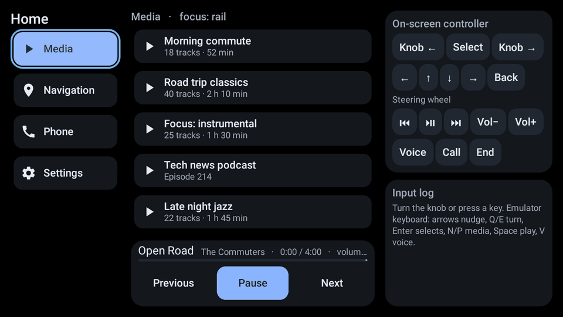
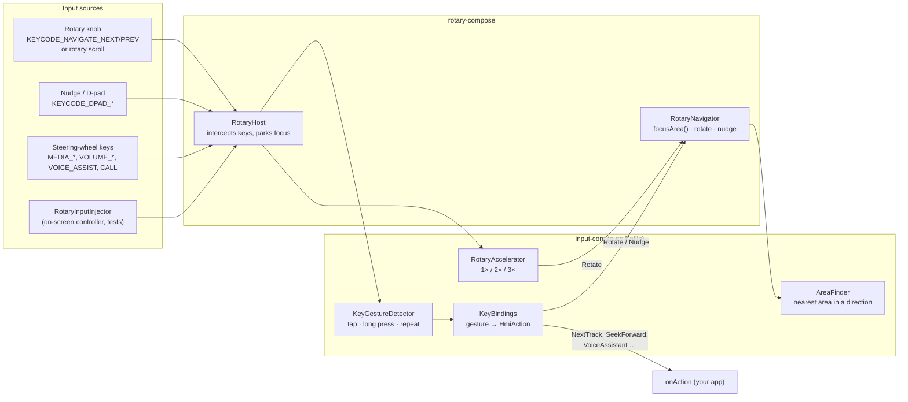

# AAOS Rotary Input: rotary controller and steering-wheel keys for Compose


[](https://jitpack.io/#namdevlondhe/aaos-rotary-input)


Drive a Jetpack Compose UI the way a car is driven: with a **rotary knob**, a **D-pad/nudge** and
**steering-wheel keys**, using the focus model of Android Automotive OS.



*Rendered by the tests on the JVM from real key events (13 steps: turn, select, nudge, accelerated spin, media
keys tapped and held, voice key). No emulator involved, so the GIF always matches the code.*

- **Focus areas, AAOS-style.** Turning the knob moves within an area (rail, list, media bar) and stops at its
  edge. Nudging jumps to the nearest area in that direction and lands on the item you last used there.
- **Gestures from raw keys.** Tap, long press and hold-repeat, both for keys that auto-repeat and for
  steering-wheel switches that only report down/up. "Tap next to skip, hold next to seek" is one binding.
- **Rotary acceleration** like RotaryService: quick detents move 2× or 3×, slow ones stay precise.
- **Focus parking and touch handling.** Focus is hidden while the user touches the screen and comes back where
  they were on the next controller input, the same rules as AAOS's FocusParkingView.
- **Testable.** The whole input pipeline is pure Kotlin with an injectable clock; focus navigation is tested
  with Compose UI tests on Robolectric.

## Architecture



## Use it

```kotlin
// settings.gradle.kts: maven("https://jitpack.io")
implementation("com.github.namdevlondhe.aaos-rotary-input:rotary-compose:<tag>") // includes input-core
```

```kotlin
RotaryHost(
    defaultArea = "rail",
    onAction = { action ->
        when (action) {
            HmiAction.NextTrack -> player.next()
            HmiAction.SeekForward -> player.seekBy(10.seconds)   // fires on long press and while held
            HmiAction.VoiceAssistant -> assistant.start()
            else -> Unit
        }
    },
) {
    Row {
        NavRail(Modifier.focusArea("rail"))
        Column {
            LazyColumn(Modifier.focusArea("content")) { /* clickable items */ }
            MediaBar(Modifier.focusArea("player"))
        }
    }
}
```

- Items are ordinary focusable/clickable composables. Select (DPAD_CENTER) is left to Compose, so `clickable`
  just works; BACK is left to `BackHandler`.
- Change any binding: `InputRouter(KeyBindings.Default.with(HardKey.Voice, GestureType.LongPress, HmiAction.Mute))`.
- Volume keys are left to the system unless you add them to `interceptedKeys`.
- `Modifier.rotaryClickable` is a `clickable` that stays focusable in touch mode, for UIs where an on-screen
  controller or a touchpad drives focus. The sample uses it.

### Default steering-wheel bindings

| Key | Tap | Hold |
|---|---|---|
| Knob (NAVIGATE_NEXT / PREVIOUS, rotary scroll) | focus ±1 in the area (accelerated) | |
| D-pad ↑ ↓ ← → | nudge to the next area | nudge |
| Media next / previous | next / previous track | seek forward / back, repeating |
| Volume + / − | volume ±1 | volume ±1, repeating |
| Voice | voice assistant | |
| Call | answer | redial |
| End call | end call | |

## Where this fits in AAOS

On a production AAOS build, the system **RotaryService** can own the rotary controller: it receives the VHAL's
rotary events and moves focus through accessibility, for apps built with car-ui-lib's `FocusArea`. Steering-wheel
switches, on the other hand, reach apps as ordinary `KeyEvent`s (VHAL `HW_KEY_INPUT` → CarInputService).

This library brings the same interaction model to **Compose**, for HMIs that receive controller input as key
events: OEM home screens and launchers with their own input routing, systems without RotaryService, the
emulator and a desktop keyboard during development. And it makes the behaviour unit-testable, which is the
part that is hardest to get right on a real car.

## Run the sample

Requires JDK 17 and the Android SDK (platform 35). Runs on an AAOS emulator, a tablet or a phone in landscape.

```bash
./gradlew :sample:installDebug
```

Drive it with the **on-screen controller**, or with the emulator's keyboard (no touch needed):

| Keyboard | Control |
|---|---|
| ← ↑ → ↓ | nudge |
| Q / E | knob counter-clockwise / clockwise |
| Enter | select |
| N / P | steering wheel next / previous (hold to seek) |
| Space, − / =, V, C | play/pause, volume, voice, call |

Or from a terminal:

```bash
adb shell input keyevent KEYCODE_NAVIGATE_NEXT          # one detent clockwise
adb shell input keyevent KEYCODE_DPAD_RIGHT             # nudge right
adb shell input keyevent --longpress KEYCODE_MEDIA_NEXT # hold "next": seek
```

## Tests

```bash
./gradlew detekt :input-core:test testDebugUnitTest
./gradlew :sample:recordRoborazziDebug && python3 scripts/make_demo_gif.py   # re-render docs/demo.gif
```

38 tests, all on the JVM:

- **input-core (19):** gesture timing with auto-repeating and down/up-only keys, timer-driven long press,
  cancelled presses; acceleration and direction changes; area selection (an area *beside* the current one is
  never "above" it); bindings and runtime rebinding
- **rotary-compose (12):** with real `KeyEvent`s through Compose: rotation stops at the area edge, nudge
  restores the last item, accelerated rotation, tap vs hold on a media key, select left to `clickable`,
  focus parking and revealing after a touch, injected input, `rotaryClickable`
- **sample (7):** the full flow, including the on-screen controller used by touch, and the scripted drive
  that renders the GIF

## Project layout

```text
input-core/       HardKey, KeyGestureDetector, RotaryAccelerator, AreaFinder, KeyBindings, InputRouter
rotary-compose/   RotaryHost, RotaryNavigator + Modifier.focusArea, rotaryClickable, RotaryInputInjector
sample/           car home screen (uses aaos-hmi-components from JitPack), tests, GIF frames
scripts/          make_demo_gif.py
```

Built on [aaos-hmi-components](https://github.com/namdevlondhe/aaos-hmi-components) for the sample's theme and
focus ring.

## License

[MIT](LICENSE) © Namdev Londhe
